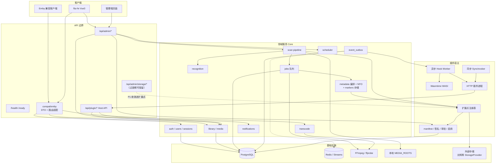

# FBZ 目标架构与落地路线

> **本文为执行真源**：插件 / 扫描 / 元数据落地与分阶段验收以本文为准；与旧计划或其它文档冲突时，以本文决策为准。  
> 文档日期：2026-10-15  
> 范围：`fbz-api` + `fbz-fe` 产品主线；**不含**后台 UI 视觉改版落地（已选定设计，另开任务）。  
> 参照：Jellyfin 公开架构概念（插件宿主/扩展点、Library Monitor、扫描流水线阶段），只借鉴边界与阶段，不抄代码；插件**打包/SDK 解耦**对齐 codex-proxy-rs（独立工程、公开 SDK、manifest 贡献点、进程外、示例另仓），**不**采用 JF/Emby 式 DLL 进程内加载。  
> 安全：文中不出现真实密钥；网关/鉴权相关改动须评审后再动。

---

## 0. 一句话定位

**FBZ = 自托管、Emby 协议兼容的媒体服务器**，后端走 **Rust modular monolith**（axum + PG + Redis + FFmpeg + Wasmtime），前端 Vue3 工作台；插件与扫描借鉴 Jellyfin「扩展点 + 发现→识别→元数据→入库→事件」思路，但用 **清单/签名/审批 + Host API 沙箱** 替代 .NET 进程内任意程序集加载。

---

## 1. 现状诊断

### 1.1 模块「乱」的具体落点

| 乱点 | 目录/文件 | 现象 | 后果 |
| --- | --- | --- | --- |
| 巨型仓储/路由 | `fbz-api/src/admin/repository.rs`（~10k 行）、`admin/routes.rs`（~5.6k）、`library/repository.rs`（~7.7k） | 多域 SQL 与 HTTP 挤在同一文件 | 改一处怕连带；难做边界测试；新人无法定位 |
| 巨型插件宿主 | `plugins/host.rs`（~4.5k）、`plugins/routes.rs`（~3k）、`plugins/repository.rs`（~2.4k） | Host API、审计、权限与路由同文件膨胀 | 扩展点新增成本高；评审困难 |
| 路由与测试混居 | `app.rs`（~5.2k，`#[cfg(test)]` 约从 L149 起占绝大部分） | 真正的 `build_router` 很薄，文件体量被集成测试撑大 | 「app 很乱」的体感；测试应迁出 |
| 双扫描链路 | `scan/service.rs`（本地 `fs::read_dir`）vs `storage/scan.rs` + `importer.rs`（云挂载 frontier） | 本地库走 `jobs.library.scan`；云库走 `storage_mounts` 状态机，且 scan 显式排除有 mount 的 library | 增量/幂等/事件语义不统一；难写统一监控 |
| 存储插件旁路 | `plugins/guangya-storage`（Node HTTP）+ `src/storage/*`，硬编码 `provider='guangya'`、`FBZ_GUANGYA_PLUGIN_URL` | **未**走 `plugin_packages` 安装→审批→启用生命周期；不具备通用 StorageProvider 扩展点 | 「插件系统没做好」的核心体感之一 |
| 元数据插件半成品 | `metadata/provider/plugin.rs` 合同与 merge 规则已有；**生产已接通** `PluginSyncInvoker`（`plugins/invoke.rs`） | P0 要验的是**示例插件 enrich**与**冻结加深内置**，不是从 `Disabled` 再重接 | 若仍按「Disabled 默认」排期会重复做已完成接线 |
| 仓库根杂项 | `demo/`、`canvas/`、`chatcontinue/` | 早期 demo、设计探索、聊天续写工具与产品代码同级 | 克隆/导航噪音；易被误当产品依赖 |
| 文档与代码漂移 | `docs/plans/2026-06-17-…`、`fbz-api/docs/plugin-system.md`、CLAUDE「迁移到 0062」vs 实际已到 `0099` | 多份计划并存，规模数字过时 | 执行时不知道以哪份为准 |
| 前端残留路径 | `fbz-fe` CLAUDE 仍提 TMDB 占位 JSON | 产品 README 已写接真实 API | 贡献者不知该改哪条数据路径 |

### 1.2 插件系统：已有能力 vs 缺口

**已具备（可保留为地基）：**

- Manifest 契约：`apiVersion=1`，`runtime ∈ {wasi, http}`，权限/hooks/schedules/menu/configSchema（`plugins/manifest.rs`）
- 生命周期：安装 → `pending_approval` → 审批/拒绝 → 启用/禁用 → 版本激活回滚（`plugin_packages` / `plugin_installations`）
- 签名：Ed25519 信封 + ZIP/manifest 绑定（`signing.rs`，`PLUGIN_TRUSTED_SIGNATURE_KEYS`）
- 异步 Hook：`event_outbox` → `plugin.hook.dispatch` → plugin worker（`hooks.rs` + `worker.rs`）
- 同步调用：`PluginSyncInvoker`（仅 http，熔断/并发/超时，`invoke.rs`）
- Host API：`/api/plugin/capabilities|config|libraries|items|metadata|artwork|markers|notifications|kv`（短时 token + 权限）
- 一等示例：`examples/plugins/http-notification-bridge`、notifier 模板、`http-marker-importer`、`wasi-scan-logger-template`

**缺口（用户痛点「插件没做好」的可执行定义）：**

1. **无一等 StorageProvider 扩展点** — 光鸭是专用模块，不是插件包；无法用同一套审批装第二个网盘源。  
2. **无扫描期扩展点** — 缺 Jellyfin 式 ItemResolver / PostScanTask；识别规则、忽略规则、后处理只能改 core。  
3. **元数据 Provider：生产已接通 SyncInvoker** — P0 验收=**示例插件 enrich** + **冻结加深内置**（**非**从 Disabled 重接）；目标态为 Provider 插件族（§5.9），非 core 内置加深。  
4. **无进程生命周期托管** — HTTP 插件需外置进程；「装包即跑」未实现（光鸭靠 compose/手启）。  
5. **扩展点清单未产品化** — capabilities 暴露权限/hook 键，但缺少「我能挂哪个扩展槽」的稳定注册表与版本策略文档。  
6. **WASI 能力偏窄** — 无网络、无原生 Host import；重活只能 http，与「首选 WASI」文档略冲突。  
7. **前端插件管理 UX 与宿主能力不同步** — 后台插件页能否完整覆盖审批/回滚/dispatch 审计需按阶段验收（本次不改 UI 视觉）。  
8. **打包/SDK 未解耦** — 示例与光鸭实现仍贴宿主仓；缺独立工程 + 公开 SDK + 示例另仓（已确认对齐 codex-proxy-rs，见 §5.0 / §5.1）。

### 1.3 扫描/元数据链路缺口

**当前本地扫描（接近可用）：**

```text
scheduler / admin 入队 jobs(job_type=library.scan)
  → scan worker claim（PG SKIP LOCKED + lease）
  → discover_media_files（游标续扫，MAX_SCAN_FILES）
  → recognize_scan_file（recognition 纯函数层）
  → upsert media_items / media_files
  → 入队 media.probe / metadata.refresh / media.photo
  → event_outbox: library.scan.{started,completed,failed}
```

**缺口：**

| 阶段 | Jellyfin 概念参照 | FBZ 现状 | 缺口 |
| --- | --- | --- | --- |
| 变更发现 | LibraryMonitor + FileRefresher debounce | 无 FS watch；依赖计划任务增量 | 无实时监控；NAS 大库只能轮询 |
| 路径解析 | IItemResolver 链 | `recognition` + 库类型先验 | 不可插件化；忽略规则弱 |
| 探针 | MediaInfo / ffprobe | `media.probe` job | 与扫描事务边界 OK；云文件探针路径另议 |
| 匹配刮削 | ProviderManager | 现状：TMDB/TVDB/Fanart + NFO（storage）多写在 core | 插件 Provider 未默认启用；**目标态** TMDB/TVDB/Fanart 亦为插件 Provider（不内置写死）；本地 NFO 与云 NFO 路径分裂 |
| 入库 | ItemRepository | library/media repository | 巨型 SQL 文件；难做幂等单测 |
| 事件 | WebSocket / 库变更 | outbox + 可选 Redis Streams | 客户端 realtime 能力分散（`realtime.rs` / Emby ws） |
| 云源 | （JF 多为本地） | `storage_mounts` 独立状态机 | 与 `library.scan` 事件/作业模型不一致 |

---

## 2. 目标愿景

### 2.1 产品能力面（Jellyfin 类，Emby 客户端兼容）

- 媒体库：电影 / 剧集 / 音乐 / 其它；本地路径 + 可插拔云存储源  
- 浏览播放：Emby REST（`/emby/*` + 无前缀别名）、直放 / STRM / HLS 转码、进度与会话  
- 元数据：库级可配源链——**NFO**（core 读本地/缓存，与 Provider 同级可配）+ **元数据 Provider 插件族**（TMDB / TVDB / Fanart / 豆瓣 / IMDb …，统一 `metadata.provider.query`，**不**内置写死在 core）+ 图片缓存（见 §5.9 / §6.4）  
- 章节与片头片尾：marker / chapter 存储与 Emby 兼容消费属 core；探测分析可插件化（见 §6.7）  
- 预告片 / 额外视频：库内 Extra 关联 + 挂载缓存选项（见 §6.5 / §6.8）  
- 用户与权限：角色、库权限、设备、下载/转码策略  
- 运维：计划任务、作业队列、活动日志、健康探针  
- 扩展：受控插件（通知、元数据 Provider 族、存储源、扫描后处理、片头片尾分析、管理菜单）

### 2.2 技术路线差异（相对 Jellyfin）

| 维度 | Jellyfin | FBZ 目标 |
| --- | --- | --- |
| 语言/运行时 | .NET，插件 DLL 进程内加载（与 Emby DLL 互不通用） | Rust 单体；插件 **WASI 沙箱** 或 **HTTP 进程外**（打包/SDK 解耦对齐 codex-proxy-rs；不做 DLL） |
| 兼容协议 | Jellyfin API | **Emby REST**（内部模型独立，compat 仅边界适配） |
| 队列 | 宿主内任务 | **PostgreSQL jobs / outbox 权威**；Redis Streams 可选镜像 |
| 插件信任 | 社区仓库 + DLL | **签名 + 管理员审批 + 权限指纹**；无裸 DB/裸盘访问 |
| 部署 | 常见单进程 | 同二进制 `FBZ_NODE_ROLE=all\|api\|worker\|scheduler` |

**不做：** 为兼容而去复制 Emby/Jellyfin 表结构；不做微服务拆分直到单机瓶颈被测量证明。

---

## 3. 目标架构图



---

## 4. 清晰模块边界

### 4.1 必须进 Core（不可插件化）

| 模块 | 职责 | 目录建议（目标态） |
| --- | --- | --- |
| 身份与会话 | 密码/Token/设备/角色 | `auth/`、`users/` |
| 库与条目模型 | libraries、media_items/files/streams、权限过滤 SQL | `library/`、`media/`（拆分巨型 repository） |
| 扫描编排 | 作业领取、游标、幂等、阶段状态机 | `scan/`（编排）；发现细节可调扩展点 |
| 识别确定性核心 | 路径→结构化识别（可配置词典，逻辑属 core） | `recognition/` |
| 元数据编排 | Provider 链顺序、合并优先级、刷新作业；**NFO** 本地/缓存读取编排（在线源实现不进 core，见 §5.9 / §6.4） | `metadata/` |
| Markers / Chapters | intro/outro/chapter 结果存储、Emby 兼容字段、播放跳过消费 | `library/` 或 `media/markers`（存储属 core） |
| 转码会话 | FFmpeg 规划、lease、并发上限 | `transcode/` |
| 作业与调度 | jobs、scheduled_tasks、lease 回收 | `jobs.rs`、`scheduler/` |
| 事件权威 | event_outbox | `events/` |
| 插件宿主本身 | 安装审批执行沙箱 | `plugins/` |
| Emby 适配 | 仅 HTTP/DTO，不拥有 SQL | `compat/emby/` |

### 4.2 必须插件化（或已承诺插件化）

| 能力 | 扩展点 ID（建议） | 运行时偏好 | 说明 |
| --- | --- | --- | --- |
| 通知出站 | `hook:playback.*` / `library.scan.*` + `notification.send` | http | 密钥在 admin targets，不在插件 |
| 元数据 Provider 族（TMDB / TVDB / Fanart / 豆瓣 / IMDb …） | `sync:metadata.provider.query` | http | **官方包可随发行附带，进程边界仍是插件**；库级开关+优先级；见 §5.9 |
| 存储源 | `rpc:storage.provider` | http | list/stat/resolve/readSmallFile/auth.* |
| 片头/片尾 / 章节探测 | `sync:media.marker.detect` 或异步 `task:media.marker.detect`（P2） | http/wasi | 分析可插件化；结果写回 core markers（§6.7） |
| 扫描后处理 | `hook:library.scan.completed` 或 `task:library.post_scan` | http/wasi | 对标 ILibraryPostScanTask |
| 路径忽略/提示 | `sync:scan.path_hint`（P2） | wasi/http | 可选；默认 core recognition |
| 管理菜单页 | `menu` + `admin.menu` | — | 仅 `/admin/plugins/{id}/**` |
| 插件自有定时 | `schedules` + `scheduler.tick` | http/wasi | 需审批启用 |

### 4.3 compat/emby 隔离规则（硬约束）

1. `compat/emby/**` **禁止**直接 `sqlx` 访问业务表；只调 domain service / repository。  
2. Emby DTO 命名与字段映射留在 `compat/emby/dto`；内部用 FBZ `media_types` / domain 模型。  
3. 新增 Emby 路由 = 适配层增量；若缺领域能力，先在 core 补 service，再挂路由。  
4. `/emby/*` 与无前缀别名必须共享同一 handler 与鉴权策略（已有计划约束，保持）。  
5. 原生管理能力走 `/api/admin/*`，不要为了图方便把管理语义塞进 Emby 路径。

### 4.4 目录收敛目标（相对现状）

```text
fbz-api/src/
  compat/emby/          # 仅适配
  domain 保持模块名，但拆文件：
    admin/{routes,service,repo_*.rs}   # 按资源切开，禁止单文件 1万行
    library/{service,repo_items,repo_files,...}
    plugins/{host/{routes,capabilities,kv,...}, ...}
  scan/{pipeline,discover,worker}     # 编排与发现分离
  storage/              # P0-P1：降级为「StorageProvider 适配 + 账号密文」
                        # 光鸭逻辑迁回 plugins 包，经扩展点调用
```

仓库根：`demo/`、`canvas/`、`chatcontinue/` → 标记 **archived / 移出默认工作区**（见 §11）。

---

## 5. 插件系统目标设计（重点）

### 5.0 已确认方向（产品决策）

两件事分开对齐，**不要混成一种「照搬」**：

| 对齐面 | 参照 | FBZ 怎么落地 |
| --- | --- | --- |
| **导入 / 打包 / SDK 解耦** | **codex-proxy-rs**（独立插件工程、公开 SDK、manifest 贡献点、进程外、示例另仓） | 插件源码不进宿主 workspace；作者只依赖公开 SDK 与契约；宿主只认包与贡献声明 |
| **扩展点能力面** | **Jellyfin**（Provider / 钩子 / 扫描后任务等「挂槽」思路） | 用稳定扩展点键 + 同步/异步触发表达同等能力；**不**采用 .NET DLL 进程内加载 |

**与 JF / Emby 插件的硬边界（写进决策，避免误期望）：**

- Jellyfin、Emby 的社区插件形态本质是 **.NET 程序集（DLL）进程内加载**；双方生态 **互不通用**（不能拿 Emby 插件装进 JF，反之亦然），也 **不能** 指望装进 FBZ。  
- FBZ **继续** `runtime ∈ {wasi, http}`：**WASI 沙箱执行**或 **HTTP 进程外**；配套 **清单 + 签名 + 管理员审批 + 权限指纹**。  
- **永不做**：任意 `DLL` / `.so` / 宿主进程内裸动态库加载（与沙箱目标相反；见 §11）。

### 5.1 工程与分发模型（对齐 codex-proxy-rs）

务实目标：作者「另开工程写插件 → 按契约打 ZIP → 管理端安装审批」，宿主不掺业务实现。

1. **独立插件工程** — 插件源码、依赖、CI 在独立仓库/目录；**禁止**把第三方插件逻辑塞进 `fbz-api` workspace 当「旁路模块」（光鸭现状要迁出，见 §5.8）。  
2. **公开 SDK** — 宿主对外只稳定暴露：manifest schema、扩展点/权限/Host API 合同、HTTP dispatch 头与同步 RPC schema、签名信封格式。SDK 可多语言（至少 Rust / Node 模板）；**不**要求作者 fork 宿主。  
3. **Manifest 贡献点（contributes）** — 包用清单声明「贡献什么、挂到哪」：hooks、schedules、menu、configSchema，以及扩展点能力（如 `metadata.provider` / `storage.provider`）。安装成功 ≠ 功能生效；须审批启用且宿主按贡献点接线。  
4. **进程外优先** — 需网络/协议/长会话的插件走 **HTTP 外置进程**（宿主 invoke + allowlist + HMAC/超时/熔断）；纯计算可走 **WASI**（仍非宿主 DLL）。「装包即跑」靠 P1 进程监督，而不是进程内加载程序集。  
5. **示例 / 官方插件另仓** — 通知桥、标记导入、StorageProvider mock、**官方元数据 Provider 包**（TMDB / TVDB / Fanart；后续豆瓣 / IMDb）、片头片尾探测示例等迁到独立仓（或组织下 `fbz-plugin-*`）；宿主仓只保留契约测试夹具。官方包可随发行附带安装，但**不**链进 core 二进制。

对照现状：现有 `plugin_packages` 生命周期、Ed25519 签名、SyncInvoker、Host API **保留为地基**；缺口主要是「旁路模块未进包」「扩展点未产品化」「示例/实现与宿主耦在一起」。

### 5.2 扩展点清单（产品契约）

能力面对齐 Jellyfin 的 Provider / 钩子思路，用 FBZ 键表达（不是接口名照搬）：

| 扩展点 | 触发方式 | 超时/失败策略 | 权限 | JF 能力面参照（仅概念） |
| --- | --- | --- | --- | --- |
| `library.scan.*` / `metadata.refresh.*` / `playback.*` / `transcode.*` / `user.login` / `scheduler.tick` | 异步 outbox | 重试+backoff；失败进 dispatch runs | 按 hook 声明 | 事件钩子 / 出站反应 |
| `metadata.provider.query` | 同步 SyncInvoker | 熔断；跳过该插件不阻断整条 Match 链 | 隐含只读输入 + 白名单写出；**全部**在线元数据源（TMDB/TVDB/Fanart/豆瓣/IMDb …）均经此槽 | Metadata Provider |
| `storage.provider.*`（**新增**） | 扫描/播放 RPC（同步） | 调用方超时；账号级限流 | `storage.account` / `storage.read`（**新增权限键**） | 可插拔媒体源 / 远程 I/O |
| `media.marker.detect`（**新增，P2**） | 作业触发：同步短结果或异步完成后写 Host | 超时/失败不阻断播放；可重试 | `media.analyze`（**新增**）+ 可选 `library.read` | Intro/Credits / Chapter 探测 |
| `library.post_scan`（**新增，P1**） | 扫描成功后异步或同步短任务 | 失败只记审计 | `library.read` | ILibraryPostScanTask |
| `scan.path_hint`（P2） | 发现阶段同步可选 | 失败忽略 hint | `library.read` | ItemResolver 提示链 |
| `webhook.received` | 入站 | 已有键，保持 | 按声明 | 入站扩展 |

**原则：** 异步 = 旁路反应；同步 = 必须进管线答案。存储解析、刮削贡献走同步；通知走异步。扩展点键进 `GET /api/plugin/capabilities` 与管理端 capabilities，作为产品契约版本化，而不是散落在代码注释里。

### 5.3 清单 / 签名 / 审批

保持现有模型，补强文档与缺口：

1. **Manifest**：现有字段为基线；贡献点用 hooks / schedules / menu / configSchema + 可选 `capabilities: ["storage.provider", ...]`（扩展点订阅优先复用事件键，避免双轨）。  
2. **签名**：生产默认拒绝未签名；开发用 `PLUGIN_ALLOW_UNSIGNED`（已有）。  
3. **审批与启用分离**：保持；权限指纹变更 → `requires_reapproval`。  
4. **Storage 插件额外审批项**：账号密文作用域、允许的 RPC ops、是否可 `resolve` 出站。  
5. **完整信任不是目标**：与「装即信」的进程内 DLL 模型相反——FBZ 即使签名通过，仍要管理员审批权限面；禁用即停调度。

### 5.4 运行时：WASI vs HTTP（继续双轨，拒绝 DLL）

| | WASI | HTTP（进程外） |
| --- | --- | --- |
| 隔离 | 强（fuel/内存/无默认网络） | 弱（靠 allowlist + HMAC + 超时） |
| 适合 | 纯计算、日志、标记、本地规则 | 网盘协议、通知、需外网刮削 |
| 同步扩展点 | P2 再评估（冷启动） | **默认允许**（已实现） |
| 运维 | 随包分发 ZIP 内模块 | **需进程托管**（systemd/compose）；P1 做「插件进程监督」最小集 |
| 与 JF/Emby | **不是** DLL 进程内；Wasmtime 沙箱执行 | 独立进程，最接近「进程外插件」 |

**光鸭**：继续 HTTP；P1 改为「正式 plugin 包 + StorageProvider 扩展点 + 独立工程」；去掉 core 内 `provider='guangya'` 特判。

### 5.5 Host API

现有路径保持稳定（兼容已装插件）。增量：

- `GET/POST` 存储相关 **不**直接给插件裸凭据；插件只收 `accountRef` + 宿主代理解密后的短时调用上下文（或宿主调插件 RPC，插件自持内存会话——与现光鸭模式对齐，但纳管进生命周期）。  
- **Markers：** 已有 markers Host 路径供探测插件写回 intro/outro/chapter（须 `media.analyze` + 白名单字段）；正式数据进 core，见 §6.7。  
- Provider 插件优先经 SyncInvoker 回传贡献，**不必**为刮削申请写 items 权限（§5.9.4）。  
- 任何新 Host 路由必须：权限键 → capabilities 文档 → 审计表。  
- 禁止插件：裸 SQL、任意路径读写、读 STRM 真实上游密钥、绕过库权限。  
- SDK 只封装上述 Host API；**不**向插件暴露内部 repository / 表结构。

### 5.6 版本兼容

- `apiVersion`：当前 `"1"`；破坏性变更升 `"2"`，双版本宿主窗口 ≥ 一个次版本。  
- 权限键与扩展点键只增不改语义；废弃键进文档与 deprecation 窗口。  
- 同步响应字段 allowlist 版本化（metadata contribution / storage RPC schema）。  
- SDK 与宿主 `apiVersion` 分开声明；插件声明目标宿主合同版本，安装前由 capabilities 校验。

### 5.7 权限沙箱

现有键保留。建议新增：

- `storage.account` — 管理账号绑定（仅 admin 场景经 Host 受限 API）  
- `storage.read` — list/stat/readSmallFile  
- `storage.resolve` — 播放直链解析（高风险，单独键）  
- `media.analyze` — 片头/片尾/章节探测：可读媒体样本或探针摘要，经 Host 写 markers（高 CPU/IO，单独键；见 §6.7 / §8.3）

风险分级继续在 `permissionDetails` 暴露给管理端。

### 5.8 相对现状的迁移路径

```text
P0  文档化扩展点注册表 + 本节已确认方向；冻结再增「旁路专用模块」
    【Provider / D1】生产已接通 SyncInvoker；P0 验收=示例插件 enrich + 冻结加深内置（非从 Disabled 重接）
    决策固化：在线元数据一律插件族（§5.9）；禁止再加深 core 内置 TMDB/TVDB/Fanart 客户端
    【源链 / D2】库级源链本轮仅配置面（开关/优先级 API/配置）；本地 NFO 进 Match 标下一档（§6.4 / §6.6）
    光鸭：补齐 plugin manifest 包（仍可 compose 启动），core 调用经薄适配层
    公开 SDK / 契约文档与宿主 capabilities 对齐（可先文档+夹具，再抽 crate/npm）

P1  StorageProvider 扩展点落地；storage/* 去掉 guangya 字符串特判
    光鸭迁出为独立插件工程（只依赖公开 SDK）
    【官方 Provider 迁出】TMDB / TVDB / Fanart 迁为独立官方插件包，经 metadata.provider.query；
      可随发行附带；core 只保留 Match 编排 + NFO 本地/缓存读取（§5.9 / §6.4）
    统一扫描作业：云发现也产出与 library.scan 兼容的阶段事件
    挂载缓存选项落地（NFO/图片/预告片，§6.5）；预告片与 Extra 关联最小可用（§6.8）
    HTTP 插件进程监督（健康检查 + 重启策略，最小）
    拆 plugins/host.rs、admin/library 巨型文件（不改对外 API）
    示例/官方插件迁独立仓；宿主只留契约测试

P2  【扩展 Provider】豆瓣 / IMDb 等官方或社区包；同一合同接入
    【片头片尾】media.marker.detect 扩展点 + media.marker.detect 作业 + 播放跳过消费（§6.7）
    post_scan / path_hint；可选 LibraryMonitor
    WASIp2 或原生 Host imports；市场/目录（0090 marketplace 迁移已有表则接线）
```


### 5.9 元数据 Provider 插件族（完整设计）

**目标：** 所有在线刮削 / 图片源走同一合同与同一生命周期；core 只做编排，不做供应商客户端。能力面对齐 Jellyfin Provider 挂槽；打包/SDK/进程外对齐 §5.0–§5.1（codex-proxy-rs）。

#### 5.9.1 统一合同

| 项 | 约定 |
| --- | --- |
| 扩展点 | `metadata.provider.query`（同步 SyncInvoker；失败熔断、跳过该源、不阻断整条 Match 链） |
| 输入 | 识别结果摘要（类型/标题/年/季集/外部 id 提示）、库类型、已有字段掩码、locale；**不含**其它源密钥 |
| 输出 | 白名单字段贡献（标题/简介/演员/外部 id/图片 URL 等）；禁止任意 JSON 穿透进业务表 |
| 合并 | core `metadata/` 按库级优先级 + 既有 merge 规则合并；后源默认不覆盖已由更高优先级填好的字段（可配「强制刷新」） |
| 清单 | `contributes` / capabilities 声明 `metadata.provider`；可选 `configSchema`（API Key、语言、成人内容开关等） |
| 密钥 | 插件配置密文走 `plugin_config_secrets`；**不**进 core 环境变量写死供应商 Key |

NFO **不是**该扩展点的实现——NFO 由 core 本地/缓存读取，但在库级源链里与 Provider **同级可配**（§6.4 / §6.6）。

#### 5.9.2 官方插件包 vs core

| 包（示意 id） | 阶段 | 说明 |
| --- | --- | --- |
| `fbz.provider.tmdb` | P1 迁出 | 电影/剧集主源之一；随发行可附带 |
| `fbz.provider.tvdb` | P1 迁出 | 剧集向；随发行可附带 |
| `fbz.provider.fanart` | P1 迁出 | 图片向；可与元数据源并行 |
| `fbz.provider.douban` | P2 | 中文社区向；合规与反爬策略由插件自持 |
| `fbz.provider.imdb` | P2 | 外部 id / 评分补充等 |
| 社区包 | 按需 | 同一合同；签名 + 审批后可进库级源链 |

**「随发行附带」≠「内置写死」：** 发行物可预装官方 ZIP 并默认启用推荐源，但运行时仍经 `plugin_packages` → 审批/启用 → SyncInvoker；禁用即退出源链。core 二进制**不**链接 TMDB/TVDB SDK。

**迁移：** 现状 core 内若仍有 TMDB/TVDB/Fanart 客户端：P0 **冻结加深**（仅允许薄适配层）+ **示例插件 enrich 验收**（生产 SyncInvoker 已接通，非从 Disabled 重接）；P1 删特判、切官方包（§5.8 / §10）。

#### 5.9.3 Core 编排职责（不可下沉到插件）

1. 维护库级「源条目」列表：NFO 槽 + 各已启用 Provider 插件实例，含开关与优先级。  
2. `metadata.refresh` 作业按链调用；单源超时/熔断 → 跳过。  
3. 字段合并、外部 id 冲突策略、刷新去抖与幂等。  
4. 图片 URL → artwork 缓存拉取（与 §6.5 / §8.4 一致）。  
5. 向 Emby compat 暴露已合并后的条目视图，而不是某单一供应商原始响应。

#### 5.9.4 与 Host API / 权限

- Provider 插件默认**不需要**写 `media_items`：贡献经 SyncInvoker 响应回传，由 core 落库。  
- 若未来允许插件补图到 Host artwork API，须显式权限键 + 审计（现有 artwork Host 路径保持受限）。  
- 禁止 Provider 插件申请 `storage.resolve` / 裸路径读写；刮削只需网络（HTTP 运行时）+ 配置密文。

交叉引用：扩展点表 §5.2；库级策略 §6.4；NFO §6.6；落地 §5.8 / §10。

---

## 6. 媒体扫描 / 元数据流水线

### 6.1 目标阶段（统一本地 + 云）

```text
1. Discover   列出候选（本地 walk / StorageProvider.list 分页）
2. Observe    size/mtime/remote version → 跳过未变（幂等）
3. Recognize  recognition::recognize（+ 可选 path_hint 插件）
4. Upsert     media_items / media_files（逻辑项 vs 物理文件分离，已有原则）
5. Probe      jobs media.probe（ffprobe；云源可跳过或延迟）
6. Match      metadata.refresh（库级源链：NFO + Provider 插件族；见 §5.9 / §6.4 / §6.6）
7. Artwork    缓存拉取（含 photo job；挂载侧见 §6.5）
8. Extras     预告片/额外视频关联或缓存（§6.8；可与 Match/Artwork 并行或随后）
9. Emit       library.scan.* + item created/updated；镜像 Redis Streams（可选）
10. PostScan  插件 post_scan（P1）
11. Markers   可选 media.marker.detect（P2；片头片尾/章节，§6.7）— 不阻塞入库与首次播放
```

对标 Jellyfin：Monitor≈Discover 触发源；Resolver≈Recognize；ProviderManager≈Match；ItemRepository≈Upsert；事件≈Emit。

### 6.2 与 jobs / worker 关系

| Job | Worker 门控 | 权威存储 |
| --- | --- | --- |
| `library.scan` | `FBZ_SCAN_WORKER_ENABLED` + role all/worker | `jobs` 表 |
| `media.probe` | probe worker | 同上 |
| `metadata.refresh` | metadata worker | 同上 |
| `media.photo` | photo worker | 同上 |
| `media.marker.detect`（P2） | marker / plugin worker | 同上；结果写 markers 表 |
| 转码会话 | transcode worker | 转码 lease 表 |
| `plugin.hook.dispatch` | plugin worker（经 outbox） | `event_outbox` |
| 计划入队 | scheduler 角色 | `scheduled_tasks` + runs |

**队列权威源：PostgreSQL。** Redis 不做 job 队列；仅缓存/协调/可选 event mirror。

### 6.3 幂等与增量

- **文件未变**：`file_observation_unchanged`（size/mtime/hash 策略）→ 跳过 upsert 下游。  
- **游标续扫**：已有 `cursor` / continuation job；保持并用于云 frontier 统一抽象。  
- **lease 回收**：各 worker 轮询 `expire_stale_running_jobs`；不得省略。  
- **插件 dispatch**：幂等键 `X-FBZ-Plugin-Idempotency-Key`；插件必须去重。  
- **全量 vs 增量**：scheduler 默认增量短周期 + 全日低峰全量（已有计划默认值，落地到配置即可）。  
- **实时监控（P2）**：可选 `notify`/`FSEvents` 式 LibraryMonitor → debounce → 局部 Discover；默认关闭，NAS 需管理员开启。

### 6.4 Match / 刮削源（库级可选策略）

对齐 JF / Emby：Match 阶段的刮削源是**媒体库级**可选策略，不是全局写死一条链。Provider 族合同见 **§5.9**；NFO 细节见 **§6.6**。

**已确认（产品决策）：TMDB、TVDB、Fanart 及后续豆瓣 / IMDb 等一律作为插件 Provider，不内置写死在 core。** NFO 由 core 读本地/缓存，与 Provider **同级**出现在库级源链。

- **可选源：**
  - **NFO** — core 读本地或 §6.5 缓存落盘（§6.6）。
  - **在线元数据 / 图片源** — TMDB、TVDB、Fanart、豆瓣、IMDb … → `metadata.provider.query`；**禁止** core 写死供应商客户端与密钥路径。
  - 社区第三方刮削同槽；安装审批启用后才进入库级源链。
- **同一条「启用 + 优先级」链：** NFO 槽 + 各已启用插件 Provider；**不再**区分「内置在线源 vs 插件 enrich」。
- **默认可推荐顺序**（创建库预填，可改）：本地 NFO 优先 → 已安装启用的官方 TMDB / TVDB（及 Fanart）→ 其它 Provider；未安装/未启用不出现在链上。
- **管理员可：** 逐源开关、调优先级；按库类型不同默认（电影 vs 剧集）。关掉的源不参与 Match。
- **编排属 core**（`metadata/`）：链顺序、合并、刷新作业、NFO 读取；插件只贡献白名单字段（§4.1 / §5.9.3）。
- **失败策略：** 单源失败或超时则跳过（SyncInvoker 熔断）。
- **迁移：** P0 示例插件 enrich + 冻结加深内置；库级源链**仅配置面**；**本地 NFO 进 Match 标下一档**；P1 官方 TMDB/TVDB/Fanart 迁出；P2 豆瓣/IMDb（§5.8 / §10）。

### 6.5 插件挂载存储：本地缓存选项

插件挂载的存储目录（StorageProvider / `storage_mounts`）相对本地路径，需在挂载（或库路径）上提供**额外**缓存开关，避免默认定时拉远端 sidecar 撑满盘：

- **可选项：** 是否将 **NFO**、**图片**（海报/背景等）、**预告片** 等缓存到本地落盘；默认可偏保守（例如仅开图片、NFO/预告片按需），由管理员显式打开。
- **落盘原则（点到为止）：** 宿主可控缓存目录（与现有 `ARTWORK_CACHE_DIR` 等对齐或并列）；须有**容量上限**与**过期 / LRU 清理**；关闭某类缓存时走远端按需读或跳过该 sidecar，**禁止**静默无限堆积。
- **与 §8.4 一致：** 缓存落盘；进程内只保留索引或短 TTL 句柄，不设无界内存表。
- **与预告片 / Extra：** 缓存开关只决定「是否落盘副本」；条目关联与播放入口见 **§6.8**。NFO 缓存供 §6.6 读取，与在线 Provider 无关。

### 6.6 NFO（可选源，与 Provider 同级）

- **阶段（D2）：** 库级源链本轮（P0）**仅配置面**；**本地 NFO 进 Match**（发现/解析进刷新链）标**下一档**，不挡 P0 配置面验收。目标态仍与 Provider 同级可配。  
- **定位：** NFO 是 Match 链上的一等可选源，**不是**插件，也**不是**凌驾于插件之上的隐式必选。库配置里与各 Provider 条目并列：可关、可调优先级。  
- **谁读：** core `metadata/` 负责发现与解析（本地库路径旁 `.nfo`，或 §6.5 缓存目录中的 NFO）。不经 SyncInvoker。  
- **谁写：** 扫描/挂载缓存任务可按开关把远端 NFO 拉到缓存；core 不强制「回写 NFO 到媒体目录」（若未来做导出，另开任务）。  
- **合并：** 与插件贡献走同一 merge 管线；典型默认「NFO 优先于在线源」，但管理员可把某 Provider 调到 NFO 之前。  
- **冲突：** NFO 缺字段时由后续 Provider 补齐；NFO 与 Provider 外部 id 不一致时以优先级高者为主，并记刷新审计（细节落地到 merge 规则，本文不锁死字段表）。  
- **云库：** 未开 NFO 缓存时，Match 可跳过 NFO 或按需 `readSmallFile`（须受 §8 与存储限流约束）；禁止为找 NFO 无界扫远端。

### 6.7 片头 / 片尾（intro / outro / chapters / markers）

对齐 Emby/JF 客户端「跳过片头/片尾」与章节列表体验：**存储与协议消费在 core，分析算法可插件化。**

#### 6.7.1 职责划分

| 层 | 职责 |
| --- | --- |
| Core | markers/chapters 表（或等价）持久化；Emby 兼容字段（IntroStart/IntroEnd、章节列表等）由 compat 映射；播放进度 API 读取并支持「跳过」；作业编排与重试 |
| 插件（可选） | 探测实现：音视频指纹、静音/黑场检测、嵌入章节解析、基于字幕/音轨启发式等；经 `media.marker.detect` 扩展点回传时间区间 |
| 非目标（短期） | 不在 core 写死某一家指纹云服务；不把探测做成扫描同步阻塞阶段 |

#### 6.7.2 作业模型

```text
触发（库选项 / 管理员 / 扫描 PostScan 可选入队）
  → jobs.media.marker.detect（按 media_file 或 media_item）
  → worker：调用已启用且具备 media.analyze 的探测插件
       （同步短结果 或 异步完成后 Host 回调写回）
  → core 校验区间合法性（0≤start<end≤duration）并 upsert markers
  → 事件：media.marker.updated（可选 outbox，供其它插件旁路）
播放：compat/emby 读 markers → 客户端展示跳过片头/片尾；core 不依赖探测插件在线
```

- **幂等：** 同一文件 + 探测器版本 + 内容指纹（size/mtime/hash）未变则跳过；管理员可强制重探测。  
- **多探测器：** 允许安装多个分析插件；库级可选「启用哪个」；冲突区间以优先级或「最新成功」策略合并（落地时定一种默认并文档化）。  
- **与扫描关系：** 属流水线第 11 步（§6.1），**默认不阻塞**入库与首次播放；大库应限流（§8.3）。

#### 6.7.3 数据与 Emby 兼容

- 内部模型用 FBZ marker 类型（如 `intro` / `outro` / `preview` / `chapter` + start/end ms + 来源插件 id）。  
- `compat/emby` 只做 DTO 映射；禁止 compat 直写 SQL（§4.3）。  
- Host API 已有 `markers` 路径：探测插件写回须走权限校验与白名单字段；插件私有草稿可用 `plugin_kv`，**正式跳过片头数据必须进 core markers**，否则 Emby 客户端看不见。

#### 6.7.4 权限与资源帽（对齐 §8）

- 权限键 `media.analyze`（§5.7）：申请即高风险展示（需读媒体样本 / 耗 CPU）。  
- 硬上限建议（配置项落地到 `config.rs`）：每节点并发探测数、单任务最长时长、单次可读媒体字节/秒帽、WASI fuel/内存沿用插件帽；与转码并发**分开计数**，避免互相饿死。  
- 云源：优先用本地缓存副本或已有 probe 摘要；禁止探测任务无限 `resolve` 拉全片。  
- 禁用插件或关闭库选项 → 停止入队；已有 markers 仍可供播放跳过，直至管理员清除。

阶段：合同与表结构可 P1 末预埋；**官方/示例探测插件与播放跳过闭环放 P2**（§5.8 / §10）。

### 6.8 预告片 / 额外视频（Extras）

- **库内关系：** 预告片、花絮等作为逻辑 Extra（或 `media_items` 关联类型）挂到主条目；扫描 Recognize 阶段可按文件名约定（`trailer`、`-trailer`、目录 `trailers/` 等）提示，细节落 recognition 词典，可后续 `path_hint` 增强。  
- **来源：** （1）媒体目录旁路文件；（2）元数据 Provider 贡献的预告片 URL（白名单字段）；（3）挂载远端 sidecar。  
- **缓存：** 仅当 §6.5「预告片缓存」打开时，宿主才把远端/URL 预告片落到缓存目录；关闭则播放时按需或仅保留本地已有文件。容量/LRU 与图片/NFO 共用护栏原则（§8.4）。  
- **Match 交互：** Provider 可贡献 trailer URL；是否下载由缓存开关决定，**不**在刮削同步路径里默认定时拉全库预告片。  
- **播放：** 走与正片相同的库权限与直放/转码策略；Extra 不单独开一套鉴权。  
- **阶段：** P1 与挂载缓存选项一起做「本地 Extra 关联 + 可选缓存」最小可用；Provider 贡献 URL 随官方包迁出；精致 Extra 类型 UX 可放 P2+（不挡架构）。

---

## 7. 运行时拓扑

### 7.1 单机 `all`（默认可落地）

```text
一个 fbz-api 进程（FBZ_NODE_ROLE=all）
  + PostgreSQL + Redis
  + 可选 guangya-storage 容器（HTTP 插件）
  + fbz-fe 静态或 dev proxy
显式打开所需 FBZ_*_WORKER_ENABLED 与 FBZ_SCHEDULER_ENABLED
```

### 7.2 拆分

```text
1× api      ：HTTP（Emby + admin + host），不跑重 worker
N× worker   ：scan/probe/metadata/photo/transcode/plugin/notification/event-mirror
1× scheduler：只跑计划任务触发入队
共享同一 DATABASE_URL / REDIS_URL
```

门控逻辑以 `main.rs` 现实现为准：role **与** per-worker flag 同时满足。

### 7.3 队列权威

- **权威：** PG `jobs`、`event_outbox`、`scheduled_task_runs`、转码 lease。  
- **非权威：** Redis Streams（`REDIS_EVENT_STREAMS_ENABLED`）— 观测与跨节点扇出。  
- 多 worker 靠 `FOR UPDATE SKIP LOCKED` + `locked_until`；不要引入第二套队列「源」。

---

## 8. 内存与泄漏护栏

> 目标：**低占用、可回落、不静默膨胀**。在已确认的「单体 + `FBZ_NODE_ROLE` 角色拆分、不先做微服务」前提下，**优先「瘦 API + 按需 worker」**，再用硬上限 + 流式 IO + 生命周期回收守住 RSS。  
> 配置真源以 `fbz-api/src/config.rs` 与各模块常量为准；下表默认值供架构对齐，调参须可观测验证。

### 8.1 优先路径：瘦 API + 按需 worker

> 落地边界与本轮 Items/navigation/PlaybackInfo 护栏清单见 [`docs/THIN_API_AND_WORKER_BOUNDARIES.md`](./THIN_API_AND_WORKER_BOUNDARIES.md)。

用户已确认：内存与待机策略上，**优先「瘦 API + 按需 worker」**，而不是先拆独立微服务仓库。

1. **待机目标：** `api` 常驻尽量瘦——只跑 HTTP（Emby + admin + Host API），不跑重 worker。`worker` / `scheduler` 可另进程部署（`FBZ_NODE_ROLE=api|worker|scheduler`，与 §7 一致）；闲时少开实例，或将相关 worker 并发缩为 0 / 采用休眠策略，有任务再拉起，避免空闲期堆常驻大堆。  
2. **重活按需：** FFmpeg、插件 HTTP 子进程用完即杀；扫描 / 转码 / 探针等由 jobs 唤醒执行，**非常驻**大堆。与 §8.5 生命周期、§8.6 回落验收一致。  
3. **对比说明：** 多微服务待机基线通常更高（每服务一份运行时、连接池与元数据缓存）。未测量证明瓶颈前，**不**拆独立微服务仓库；与 §2.2 / §11「微服务拆分不做」一致。  
4. **验收：** 记录空闲 RSS（仅 `api` 角色）与来任务后的峰值、以及回落至基线附近的时间（见 §8.6）。

### 8.2 基线原则（单体为何更省）

1. **同进程共享连接池与缓存，避免每服务一份 PG/Redis/HTTP 客户端与重复元数据缓存。** 角色拆分（`api` / `worker` / `scheduler`）只关 worker 门控，不复制整栈。  
2. **热路径少分配：** 扫描/探针/转码按批或按 job 处理；禁止「一次扫完全库进内存再写库」。  
3. **峰值可解释：** 转码并发、扫描批、插件 WASI/HTTP 帽是主要尖峰来源；尖峰后 RSS 必须回落（见 §8.6）。  
4. **泄漏当缺陷：** 压测后 RSS 台阶上升、WS/session/子进程只增不减，一律按 bug 修，不靠加机器掩盖。  
5. **微服务推迟到测量证明瓶颈：** 与 §2.2 / §11「明确不做」及 §8.1 优先路径一致；拆服务前先收紧本节帽与生命周期。

### 8.3 硬上限（必须有配置或常量）

| 域 | 模块 | 默认 / 约定 | 环境变量或常量 | 护栏意图 |
| --- | --- | --- | --- | --- |
| 转码并发 | `transcode/` | **3** | `TRANSCODE_MAX_CONCURRENT`（禁止为 0） | 限制 FFmpeg 子进程与缓冲峰值 |
| 转码 lease | `transcode/` | **900s** | `TRANSCODE_LEASE_SECONDS` | 僵死会话可被回收，防会话表与磁盘堆积 |
| 扫描批大小 | `scan/service.rs` | **10_000** 文件/游标批 | `MAX_SCAN_FILES` | 大库分批；游标续扫，禁止无量载入 |
| 插件 WASI 内存 | `plugins/wasi.rs` | **128 MiB**/次执行 | `PLUGIN_MEMORY_LIMIT_MB` + `StoreLimits` | 沙箱硬顶；超限 trap，不拖垮宿主 |
| 插件 WASI fuel | `plugins/wasi.rs` | **1e8** | `PLUGIN_WASI_FUEL` | 防死循环占满 CPU/时间 |
| HTTP 插件响应体 | `plugins/invoke` / config | **64 KiB**（上限 ≤1 MiB） | `PLUGIN_HTTP_MAX_RESPONSE_BODY_BYTES` | 防恶意/失控大包灌内存 |
| 同步调用并发 | `plugins/invoke.rs` | **每插件 4** | `PLUGIN_SYNC_MAX_CONCURRENCY_PER_PLUGIN` | 刮削/存储 RPC 背压 |
| 同步超时 / 熔断 | `plugins/invoke.rs` | **10s**；失败阈值与冷却 | `PLUGIN_SYNC_TIMEOUT_MS` 等 | 慢插件不堆协程 |
| 片头片尾探测并发 | marker worker（P2） | **1–2**/节点（默认偏低） | `MARKER_DETECT_MAX_CONCURRENT`（建议） | 与转码分帽；防指纹/解码打满盘与 CPU（§6.7） |
| 单次探测时长 | marker worker（P2） | **建议 ≤300s** | `MARKER_DETECT_TIMEOUT_SEC`（建议） | 超时杀进程/丢弃 WASI Store；可重试 |
| 作业 lease | `jobs` / workers | 既有 `locked_until` + `expire_stale_running_jobs` | （各 worker 轮询） | 崩溃任务释放，防队列假忙与重试风暴 |

调大任一帽之前：先看压测 RSS 曲线与回落；默认「宁排队、不爆内存」。

### 8.4 流式 IO 与缓存边界

- **媒体与转码：** 读写走流式 / 分段（HLS segment、FFmpeg pipe）；禁止把整部影片或完整转码产物 `read_to_end` 进进程堆。转码工作目录 `TRANSCODE_CACHE_DIR`（默认 `./var/transcode`）按会话清理。  
- **扫描发现：** `discover_media_files` 游标 + `MAX_SCAN_FILES`；识别结果逐条 upsert，不累积巨型 `Vec` 跨批持有。  
- **海报 / 插件缓存：** `ARTWORK_CACHE_DIR`、`PLUGIN_CACHE_DIR` 落盘；进程内只保留索引或短 TTL 句柄，不设无界 HashMap。  
- **Redis：** 仅缓存/协调/可选 event mirror（§7.3）；**不做**大对象 job 载荷仓库；键带 TTL 或显式失效路径。  
- **插件 KV / Host API：** 单次读写与 `host_api_max_calls_per_run` 受限；禁止插件通过 Host API 拉全库列表反复堆本地。

### 8.5 子进程 / 会话 / WS 生命周期

| 资源 | 模块 | 必须做到 |
| --- | --- | --- |
| FFmpeg / ffprobe | `transcode/`、`media` probe | 会话结束、lease 过期、客户端断开 → kill 进程组并删临时目录；worker 重启扫僵死 lease |
| HTTP 插件进程 | `plugins/` + 部署侧 | 超时/熔断后不再堆积 in-flight；监督健康检查；禁用插件后停止调度 |
| 片头片尾探测 | marker / plugin（P2） | 超时 kill；禁用 `media.analyze` 插件后停止入队；临时采样文件进缓存目录并限期删 |
| WASI 执行 | `plugins/wasi.rs` | 单次 `Store`；fuel/内存用尽即丢弃；无跨请求复用可增长全局状态 |
| 播放 / 设备会话 | `sessions`、DB | 过期与登出清理；列表接口分页（如 admin 转码会话 list clamp） |
| Emby WebSocket | `realtime::SessionMessageHub`、`compat/emby/routes/ws.rs` | 注册 generation；断线 `unregister`；死通道 `send` 失败顺手清理；同会话新连接替换旧连接 |
| jobs / outbox | workers | `expire_stale_running_jobs` 不得省略；outbox 有保留/清理策略（与 §9.1 审计保留一致） |

多 API 节点时：WS 粘滞到接入节点（`realtime.rs` 注释已说明）；跨节点扇出未就绪前不要复制无界本地 hub 状态。

### 8.6 可观测与验收

1. **空闲基线（仅 api）：** 无扫描/转码/插件重活时，单独记录 `FBZ_NODE_ROLE=api`（或等价门控）进程 RSS，作为待机目标对照（§8.1）。  
2. **RSS / 工作集曲线：** 进程级（含 worker）导出或主机监控；标注扫描高峰、转码高峰、插件同步高峰；并标注「空闲 → 峰值 → 回落」时间点。  
3. **压测后回落：** 代表性场景（大库增量扫、N 路并发转码顶满 `TRANSCODE_MAX_CONCURRENT`、插件 sync 打满每插件并发）结束后，冷却期内 RSS 回到基线附近（允许小幅分配器保留，不允许单调台阶）；**验收须同时给出空闲 RSS、峰值与回落时间。**  
4. **资源计数：** 活跃 `transcode_sessions`、FFmpeg 子进程数、`SessionMessageHub` 通道数、plugin in-flight、jobs `running`；应与业务并发同阶，而非随时间爬升。  
5. **回归门槛：** 改扫描批、转码并发、插件帽或 WS 路径的 PR，附带「峰值 + 回落」说明或 smoke；泄漏复现优先于加默认并发。

### 8.7 禁止事项

- 无界内存缓存（无 TTL、无容量上限的 `HashMap` / `Vec` 常驻）。  
- 一次性加载整库路径、整表 artwork、整段无上限插件响应。  
- 为「省事」把转码/扫描默认并发调到机器核数以上且无回落验证。  
- 忽略 lease 回收、WS 不 unregister、FFmpeg 孤儿进程。  
- 用微服务拆分逃避单体泄漏（未测量前不做；先走 §8.1 瘦 API + 按需 worker）。  
- 在文档或仓库中写真实密钥、签名私钥、DB 口令（与文首安全约定一致）。

---

## 9. 数据模型原则

### 9.1 原则（不列全量 SQL）

1. **热路径用 bigint PK；对外/Emby 用 `public_id uuid`。**  
2. **逻辑媒体 `media_items` ≠ 物理 `media_files` ≠ 探针 `media_streams`。**  
3. **权限过滤在 repository 查询内完成**，禁止上层事后 filter。  
4. **大表 keyset 分页**；审计/outbox/dispatch runs 带保留策略。  
5. **迁移只增不改破坏性结构**（除非显式变更单）。  
6. **密钥不出业务 JSON**：`notification_target_secrets`、`plugin_config_secrets`、storage 账号密文；AAD 绑定用途。  
7. **插件私有数据：** `plugin_kv`；不得建插件直连业务表。  
8. **存储索引：** `storage_accounts` / `storage_mounts` / `storage_entries` 属 core 索引，插件只提供远程 I/O。  
9. **正式 markers（intro/outro/chapter）属 core 表**，供 Emby 播放消费；插件探测结果经 Host/作业写入，插件作用域草稿不得替代 core markers（§6.7）。  
10. **库级元数据源链配置**（NFO 槽 + Provider 插件引用与优先级）属 library 配置，不进插件私有 KV。

### 9.2 关键实体（心智模型）

```text
roles, users, devices, sessions, api_keys
libraries, library_paths, user_library_access
media_items, media_files, media_streams, artwork…
media_markers / chapters（intro/outro/chapter；Emby 跳过片头消费）
library 元数据源链配置（NFO + provider 插件引用）
jobs, job_runs
scheduled_tasks, scheduled_task_runs
event_outbox
plugin_packages, plugin_installations, plugin_permissions,
plugin_hooks, plugin_menu_items, plugin_schedule_definitions, plugin_kv
plugin_sync_invocations, plugin dispatch/runs（执行审计）
notification_targets, notification_target_secrets, notification_requests
storage_accounts, storage_mounts, storage_entries
transcode_sessions（及 lease 字段）
```

---

## 10. 分阶段落地（可执行）

### P0 — 收敛「乱」+ Provider 示例验收 + 源链配置面（约 1–2 周可验收）

**目标：** 架构可读；**生产已接通 SyncInvoker** 前提下，用**示例插件 enrich**证明合同可用，并**冻结加深内置**；库级源链本轮**仅配置面**；本地 NFO 进 Match 标下一档。

| 动作 | 改哪些目录 | 验收 | 风险 |
| --- | --- | --- | --- |
| 固化本文为执行真源；旧计划文首加「被本文取代的决策以本文为准」 | `docs/` | 贡献者只指本文 + plugin-system.md | 低 |
| 迁出 `app.rs` 集成测试到 `tests/` 或 `src/app_tests.rs` | `app.rs`、`tests/` | `app.rs` 生产代码 < 200 行；`cargo test` 过 | 低 |
| **【P0 / D1】示例插件 enrich + 冻结加深内置**（生产已接通 SyncInvoker；**非**从 Disabled 重接） | `metadata/`、`examples/plugins/`、评审约定 | 订阅 `metadata.provider.query` 的示例 http 插件可 enrich；core 内置 TMDB/TVDB/Fanart **不再加深**（§5.9） | 中：超时拖慢刷新 → 靠已有熔断 |
| **【P0 / D2】库级源链仅配置面**：开关/优先级 API 或配置（UI 另任务）；**不含**本地 NFO 进 Match | `library/`、`metadata/` | 配置面可表达源开关/优先级；无「隐式内置在线源优先」；本地 NFO→Match 标下一档 | 中 |
| 光鸭打成正式 plugin 包清单（即便进程仍 compose） | `plugins/guangya-storage/`、`docs` | 管理端能看到包/权限声明；RPC 仍工作 | 中：勿把密钥写入 manifest |
| 冻结新旁路：禁止再增 `src/*` 硬编码第三方 Provider 字符串；禁止加深 core TMDB/TVDB | 约定 + CODEOWNERS/评审 | PR 检查 | 低 |
| 根目录杂项标记 | `demo/` `canvas/` `chatcontinue/` 加 README「非产品」 | 主 README 架构树不再并列强调 | 低 |

**P0 不做：** UI 改版、LibraryMonitor、拆 admin 万行、官方 TMDB 包迁出（属 P1）、**本地 NFO 进 Match**（下一档）、片头片尾探测（属 P2）、从 Disabled 重接 SyncInvoker（已完成）。

### P1 — 官方 Provider 迁出 + 存储扩展点 + 扫描统一（约 2–4 周）

**目标：** 演示「换存储源 / 换刮削源不必改 core」；官方 TMDB/TVDB/Fanart 以插件包运行；挂载缓存与预告片最小可用。

| 动作 | 目录 | 验收 | 风险 |
| --- | --- | --- | --- |
| **【P1 Provider】TMDB / TVDB / Fanart 迁出**为独立官方插件工程；经 `metadata.provider.query`；可随发行附带 | `metadata/` 删内置客户端、`fbz-plugin-*` | core 无供应商 SDK；装包启用后刮削闭环；禁用即退出源链 | 高：刷新回归 / Key 配置迁移 |
| 定义 `storage.provider` RPC schema + 权限键 | `plugins/manifest.rs`、`host`/`invoke`、migrations | capabilities 列出；契约测试 | 中：与现光鸭协议对齐需适配层 |
| `storage/*` 改为扩展点客户端；删除 `guangya` 特判 | `storage/` | 光鸭仅作插件实现；第二 mock provider 可挂载 | 高：播放 302 / 扫描回归 |
| 云发现纳入 scan 阶段模型或桥接同一事件 | `scan/`、`storage/scan.rs` | 云库扫描也发 `library.scan.*`；监控同一套 | 中 |
| **挂载缓存选项**（NFO/图片/预告片）+ Extra 本地关联最小集（§6.5 / §6.8） | `storage/`、`metadata/`、`library/` | 开关生效；有容量上限；关缓存不撑盘 | 中 |
| 拆分 `admin/repository.rs`、`library/repository.rs`、`plugins/host.rs` 按资源 | 上述 | 单文件 < ~1500 行；行为不变 | 中：合并冲突 |
| HTTP 插件最小进程监督（compose health / 可选 sidecar 管理 API） | `docs/deployment.md`、scripts | 光鸭/官方 Provider 挂了能被发现 | 低 |
| （可选预埋）markers 表结构 / Emby 字段映射骨架，**不**开探测 worker | migrations、`compat/emby` | 不影响播放；为 P2 铺路 | 低 |

**鉴权/网关：** 本阶段若动 Host token 或 admin 鉴权，单独评审；默认只加权限键与 RPC，不改 Emby 鉴权。

### P2 — 豆瓣/IMDb + 片头片尾 + 体验扩展（按需）

- **【P2 Provider】** 豆瓣 / IMDb 等官方或社区包，同一 `metadata.provider.query` 合同接入；合规/反爬策略由插件自持  
- **【P2 片头片尾】** `media.marker.detect` 扩展点 + `media.marker.detect` 作业 + 权限 `media.analyze` + 资源帽（§6.7 / §8.3）；播放跳过片头闭环；示例/官方探测插件另仓  
- LibraryMonitor（可选实时发现）+ debounce  
- `library.post_scan` / `scan.path_hint`  
- WASIp2 或 Host imports；插件市场表接线  
- Extra / 预告片 UX 细化（不挡播放）  
- admin/FE 插件管理完整审计 UX（**独立 UI 任务**，不与本架构文档绑死视觉）  
- 测量后再谈 worker 水平扩展与 DB 分区（已有 `database-scale.md`）

每阶段通用验收：`cargo test`、相关 smoke（`smoke-plugin-lifecycle` / `smoke-plugin-runtime`）、播放闭环（见 `docs/PLAYBACK_LOOP_20261004.md`）不回退。

---

## 11. 明确不做（短期冻结 / 砍掉噪音）

| 项 | 处理 | 理由 |
| --- | --- | --- |
| `demo/` | 冻结；移出主文档入口 | 早期静态 demo，非产品 |
| `canvas/` | 冻结为设计资产 | 与运行时无关 |
| `chatcontinue/` | 移出产品路径或 gitignore 工作流 | 编辑器续写工具，污染仓库根 |
| 后台 UI 视觉大改 | **另任务**；本架构不包含 | 用户已选定设计但要求先架构 |
| Jellyfin 协议兼容 | 不做 | 已确认 Emby-only |
| 微服务拆分 | 不做 | 同二进制角色拆分足够 |
| 插件任意 DLL/.so 加载（含 JF/Emby 式进程内程序集） | 永不做 | 与沙箱目标相反；JF/Emby 插件互不通用且不可装入 FBZ |
| 媒体/海报进 PostgreSQL | 不做 | 已有硬约束 |
| 为「可能需要」再建抽象层 | 克制 | backend-execution-goal 原则 |
| 在 compat 层写业务 SQL | 禁止 | 边界腐蚀 |
| 未审批改鉴权/网关默认策略 | 禁止 | 安全 |

---

## 12. 成功标准（本文落地后）

1. 团队以本文 + `fbz-api/docs/plugin-system.md` + `plugin-development.md` 为插件/扫描决策真源。  
2. P0 完成后：示例插件经已接通的 SyncInvoker enrich 可验收；core 内置加深已冻结；库级源链**配置面**可用（本地 NFO 进 Match 属下一档）；光鸭具备插件包身份；`app.rs` 测试外迁。  
3. P1 完成后：官方 TMDB/TVDB/Fanart 以插件包运行；存储源可按扩展点替换；core 无供应商 SDK/字符串特判；扫描事件语义统一；挂载缓存选项可用。  
4. P2 完成后：豆瓣/IMDb 等可同合同接入；片头片尾探测→markers→播放跳过闭环可演示。  
5. 仓库根杂项不再被误认为交付物；文档中不再出现「内置 TMDB/TVDB 写死 core」的目标态表述。

---

## 附录 A — 现状关键路径速查

```text
fbz-api/src/main.rs          角色与 worker 门控
fbz-api/src/app.rs           路由合并（测试应外迁）
fbz-api/src/scan/            本地扫描
fbz-api/src/storage/         云存储（待扩展点化）
fbz-api/src/plugins/         宿主
fbz-api/src/metadata/        刮削
fbz-api/src/recognition/     识别
fbz-api/src/compat/emby/     Emby 适配
fbz-api/plugins/guangya-storage/  光鸭 HTTP 插件实现
fbz-api/docs/plugin-system.md
fbz-api/docs/deployment.md
```

## 附录 B — Jellyfin 概念映射（仅边界）

| Jellyfin | FBZ |
| --- | --- |
| PluginManager + **DLL 进程内**（与 Emby DLL **互不通用**） | plugins 生命周期 + **WASI\|HTTP** + 签名审批（对齐 codex-proxy-rs 打包/SDK；**不做** DLL/.so） |
| IPlugin / meta.json | manifest.json + apiVersion + 贡献点（hooks/capabilities） |
| ILibraryPostScanTask | hook / post_scan 扩展点 |
| Provider 插件 | SyncInvoker + metadata.provider.query（官方包可附带，非 DLL 内置） |
| Intro / chapters | core markers + `media.marker.detect` 插件（P2） |
| LibraryMonitor | P2 可选；现用 scheduler 增量 |
| LibraryManager 扫描 | scan pipeline + jobs |
| ItemResolver | recognition（+ 未来 path_hint） |
| Trailers / extras | 库内 Extra 关联 + §6.5 缓存选项（§6.8） |

---

*本文为执行真源（见文首）。由架构勘察基于仓库只读分析生成，不包含密钥与可运行 exploit。实施时按 P0→P1→P2 开 PR，每 PR 保持可回滚。决策修正（D1/D2）已写入 §1 / §5.8 / §6.4 / §6.6 / §10 / §12。*
